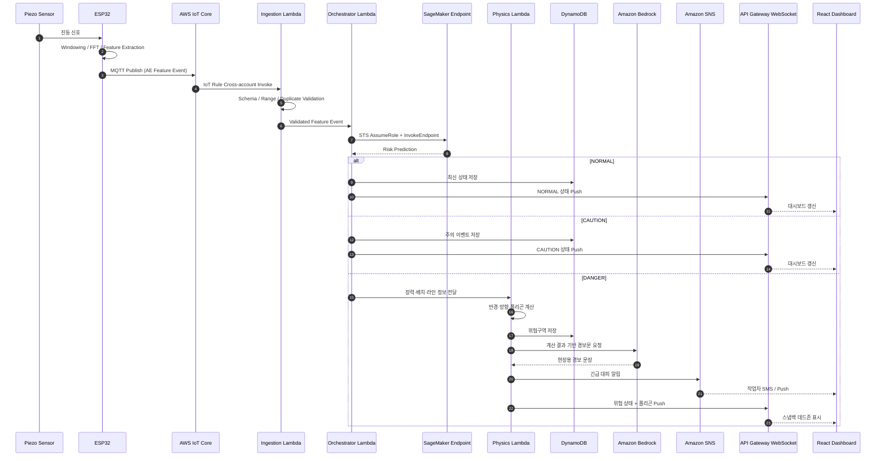
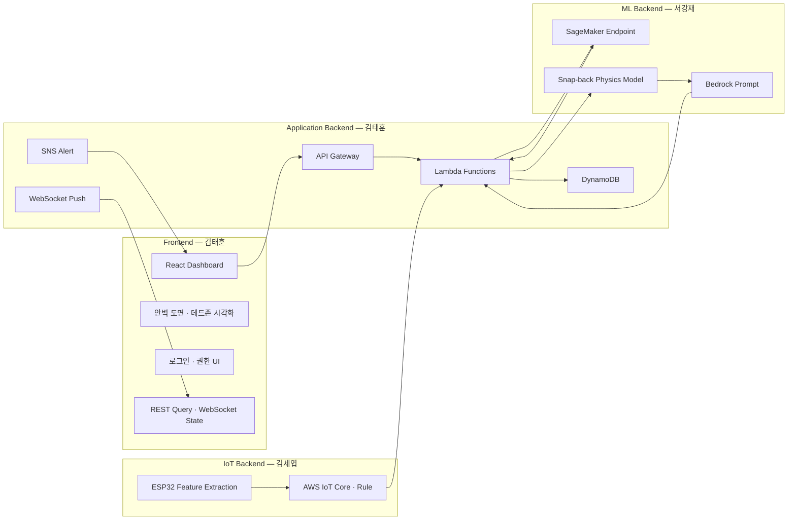
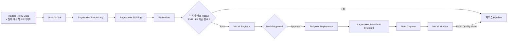

# AE-Sentinel 권장 AWS 전체 아키텍처

> 음향 방출(AE) 기반 계류삭 파단 예측 및 스냅백 위험구역 관제 시스템  
> 기준: **3인 팀 · 3개 AWS 계정 · React 서버리스 웹 · IoT 이벤트 기반 추론 · SageMaker ML**

---

## 1. 권장 계정 분리

| AWS 계정 | 담당 | 핵심 서비스 |
|---|---|---|
| **Account A — Application / Full-stack** | 김태훈 | Amplify Hosting, Cognito, API Gateway, Lambda, DynamoDB, SNS, CloudWatch |
| **Account B — Edge / IoT** | 김세엽 | AWS IoT Core, IoT Rule, S3 센서 데이터, SQS DLQ |
| **Account C — ML / AI** | 서강재 | SageMaker Pipeline, Training, Model Registry, Endpoint, Bedrock, ML 데이터 S3 |

> 계정은 분리하되, 서비스 런타임의 중심은 **Account A의 Application Backend**로 둔다.

---

# 2. 전체 시스템 아키텍처

```mermaid
flowchart LR
    %% =========================================================
    %% FIELD / EDGE
    %% =========================================================
    subgraph FIELD["현장 / Edge"]
        direction TB

        SENSOR["압전 진동 센서<br/>Piezo / AE Sensor"]
        AFE["아날로그 프론트엔드<br/>증폭 · 필터링 · 보호회로"]
        ESP32["ESP32 Edge Processor<br/>Sampling · Windowing · FFT<br/>Feature Extraction"]
        LOCAL["Local Fail-safe<br/>LED · Buzzer · 절대 임계치 경보"]

        SENSOR -->|"진동 신호"| AFE
        AFE -->|"ADC 입력"| ESP32
        ESP32 -->|"로컬 위험 임계치"| LOCAL
    end

    %% =========================================================
    %% ACCOUNT B - IOT
    %% =========================================================
    subgraph IOTACC["AWS Account B — Edge / IoT"]
        direction TB

        IOTCORE["AWS IoT Core<br/>MQTT Broker<br/>X.509 Device Authentication"]
        IOTRULE["AWS IoT Rule<br/>Topic Filter · Message Routing"]
        IOTS3["Amazon S3<br/>Raw / Feature Sensor Data"]
        DLQ["Amazon SQS DLQ<br/>IoT 처리 실패 이벤트"]
        IOTCW["Amazon CloudWatch<br/>IoT Logs · Metrics"]

        IOTCORE --> IOTRULE
        IOTRULE -->|"선택적 원시·특징 보관"| IOTS3
        IOTRULE -.->|"Error Action"| DLQ
        IOTCORE -.-> IOTCW
    end

    ESP32 -->|"MQTT over TLS<br/>AE Feature Event"| IOTCORE

    %% =========================================================
    %% ACCOUNT A - APPLICATION
    %% =========================================================
    subgraph APPACC["AWS Account A — Full-stack Application / Runtime"]
        direction TB

        subgraph WEB["Serverless Web Application"]
            direction TB

            AMPLIFY["AWS Amplify Hosting<br/>React Dashboard · CI/CD · CDN"]
            COGNITO["Amazon Cognito<br/>관제 사용자 인증 · JWT"]
            APIGW["Amazon API Gateway<br/>HTTP REST API"]
            WSGW["Amazon API Gateway<br/>WebSocket API"]

            COGNITO -->|"JWT 인증"| AMPLIFY
            AMPLIFY -->|"HTTPS REST + JWT"| APIGW
            AMPLIFY <-->|"실시간 상태 Push"| WSGW
        end

        subgraph BACKEND["Serverless Application Backend"]
            direction TB

            INGEST["Ingestion Lambda<br/>스키마 검증 · 중복 검사<br/>단위·범위 검증"]
            ORCH["Inference Orchestrator Lambda<br/>ML 호출 · 위험 판정<br/>전체 흐름 조정"]
            QUERY["Query Lambda<br/>라인 상태 · 이벤트 이력 조회"]
            PHYSICS["Snap-back Physics Lambda<br/>반경 · 방향 · 폴리곤 계산"]
            ALERT["Alert Lambda<br/>중복 알림 방지 · 발송 정책"]
            WSLAMBDA["WebSocket Lambda<br/>연결 관리 · 실시간 Push"]

            APIGW --> QUERY
            WSGW --> WSLAMBDA
            INGEST --> ORCH
            ORCH --> PHYSICS
            ORCH --> ALERT
            ORCH --> WSLAMBDA
        end

        DDB["Amazon DynamoDB<br/>라인 최신 상태 · 이벤트 · 알림 이력<br/>WebSocket Connection ID"]
        SNS["Amazon SNS<br/>SMS · Email · Mobile Push"]
        APPS3["Amazon S3<br/>안벽 도면 · 정적 자산 · 이벤트 첨부"]
        APPCW["Amazon CloudWatch<br/>Logs · Metrics · Alarm"]
        EVENTBRIDGE["Amazon EventBridge<br/>비동기 이벤트 · 배포 상태"]

        QUERY --> DDB
        ORCH --> DDB
        PHYSICS --> DDB
        ALERT --> SNS
        QUERY --> APPS3
        INGEST -.-> APPCW
        ORCH -.-> APPCW
        QUERY -.-> APPCW
        WSLAMBDA -.-> APPCW
    end

    %% Cross-account IoT ingestion
    IOTRULE -->|"Cross-account Invoke<br/>Lambda Resource Policy"| INGEST

    %% =========================================================
    %% ACCOUNT C - ML
    %% =========================================================
    subgraph MLACC["AWS Account C — ML / AI"]
        direction TB

        subgraph TRAINING["Model Training & MLOps"]
            direction TB

            MLS3["Amazon S3<br/>Proxy Data · Real AE Data<br/>Train / Validation / Test"]
            PROCESS["SageMaker Processing<br/>전처리 · 정규화 · Feature Engineering"]
            TRAIN["SageMaker Training<br/>AE 손상 분류 모델"]
            EVAL["Evaluation Step<br/>Recall · FNR · F1 · Latency"]
            CONDITION{"Condition Step<br/>품질 기준 충족?"}
            REGISTRY["SageMaker Model Registry<br/>Version · Metadata · Approval"]
            DEPLOY["Deployment Pipeline<br/>Approved Model 배포"]

            MLS3 --> PROCESS
            PROCESS --> TRAIN
            TRAIN --> EVAL
            EVAL --> CONDITION
            CONDITION -->|"Yes"| REGISTRY
            CONDITION -->|"No"| STOP["Pipeline 종료<br/>재학습 필요"]
            REGISTRY -->|"Manual / Automatic Approval"| DEPLOY
        end

        ENDPOINT["SageMaker Real-time Endpoint<br/>NORMAL · CAUTION · DANGER"]
        BEDROCK["Amazon Bedrock<br/>현장용 경보문 · 다국어 설명<br/>물리 좌표 계산 금지"]
        CAPTURE["SageMaker Data Capture<br/>추론 입력·출력 저장"]
        MONITOR["SageMaker Model Monitor<br/>Data Drift · Quality Monitoring"]
        MLCW["Amazon CloudWatch<br/>Endpoint Latency · Error · Alarm"]

        DEPLOY --> ENDPOINT
        ENDPOINT --> CAPTURE
        CAPTURE --> MONITOR
        ENDPOINT -.-> MLCW
        MONITOR -.-> MLCW
    end

    %% Cross-account inference
    ORCH -->|"STS AssumeRole<br/>sagemaker:InvokeEndpoint"| ENDPOINT
    ENDPOINT -->|"Prediction JSON"| ORCH

    %% Bedrock is used only after deterministic physics calculation
    PHYSICS -->|"결정론적 계산 결과"| BEDROCK
    BEDROCK -->|"경보 문장"| ALERT

    %% Cross-account training data sharing
    IOTS3 -.->|"S3 Bucket Policy<br/>KMS Key Policy"| MLS3

    %% Deployment event
    REGISTRY -.->|"Model Approval Event"| EVENTBRIDGE
    EVENTBRIDGE -.->|"배포 상태·운영 이벤트"| DDB

    %% =========================================================
    %% USER
    %% =========================================================
    subgraph USERS["사용자"]
        WORKER["현장 작업자<br/>SMS · Push 수신"]
        OPERATOR["안전관리자 / 관제실<br/>React Dashboard"]
    end

    SNS --> WORKER
    AMPLIFY --> OPERATOR

    %% =========================================================
    %% STYLES
    %% =========================================================
    classDef edge fill:#f1f5f9,stroke:#475569,color:#0f172a,stroke-width:1.5px;
    classDef iot fill:#ecfdf5,stroke:#15803d,color:#14532d,stroke-width:1.5px;
    classDef app fill:#eff6ff,stroke:#2563eb,color:#1e3a8a,stroke-width:1.5px;
    classDef compute fill:#fff7ed,stroke:#ea580c,color:#7c2d12,stroke-width:1.5px;
    classDef ml fill:#f0fdfa,stroke:#0f766e,color:#134e4a,stroke-width:1.5px;
    classDef genai fill:#faf5ff,stroke:#7e22ce,color:#581c87,stroke-width:1.5px;
    classDef storage fill:#f7fee7,stroke:#4d7c0f,color:#365314,stroke-width:1.5px;
    classDef alert fill:#fff1f2,stroke:#dc2626,color:#881337,stroke-width:1.5px;
    classDef user fill:#ffffff,stroke:#64748b,color:#0f172a,stroke-width:1.5px;

    class SENSOR,AFE,ESP32,LOCAL edge;
    class IOTCORE,IOTRULE,DLQ,IOTCW iot;
    class AMPLIFY,COGNITO,APIGW,WSGW app;
    class INGEST,ORCH,QUERY,PHYSICS,ALERT,WSLAMBDA compute;
    class DDB,APPS3,IOTS3,MLS3 storage;
    class SNS alert;
    class PROCESS,TRAIN,EVAL,REGISTRY,DEPLOY,ENDPOINT,CAPTURE,MONITOR,MLCW ml;
    class BEDROCK genai;
    class WORKER,OPERATOR user;
```



---

# 3. 핵심 실시간 데이터 흐름



---

# 4. 프론트엔드와 Application Backend 경계



## 역할 해석

- **Frontend**는 React 화면만 의미하지 않는다.
- 김태훈 담당은 **Full-stack Application & Integration**이다.
- IoT 팀은 `정규화된 AE Feature Event`를 Application Backend까지 전달한다.
- ML 팀은 `Inference Request → Prediction Response` 계약을 제공한다.
- Application Backend는 IoT와 ML 결과를 조합하여 저장·알림·웹 전송을 담당한다.

---

# 5. 모델 학습 및 배포 흐름



## 권장 모델 승인 기준

| 지표 | 권장 기준 예시 |
|---|---:|
| 위험 클래스 Recall | `≥ 0.90` |
| 위험 클래스 False Negative Rate | `≤ 0.10` |
| Macro F1 Score | `≥ 0.85` |
| 추론 지연시간 | PoC 기준 별도 측정 |
| Confusion Matrix | NORMAL/CAUTION/DANGER 검토 |

> 산업 안전 시스템에서는 Accuracy보다 **위험 상태를 정상으로 놓치는 False Negative**를 우선 관리한다.

---

# 6. API 구조

## REST API

| Method | Path | 설명 |
|---|---|---|
| `GET` | `/lines` | 전체 계류삭 최신 상태 조회 |
| `GET` | `/lines/{lineId}` | 특정 계류삭 상세 상태 조회 |
| `GET` | `/events` | 위험·주의 이벤트 목록 조회 |
| `GET` | `/events/{eventId}` | 이벤트 상세 조회 |
| `GET` | `/dashboard/summary` | 대시보드 요약 통계 |
| `POST` | `/alerts/test` | 테스트 경보 발생 |
| `POST` | `/alerts/{eventId}/ack` | 경보 확인 처리 |

## WebSocket 이벤트

| Event Type | 설명 |
|---|---|
| `line.status.updated` | 계류삭 최신 상태 갱신 |
| `risk.caution.detected` | 주의 위험도 감지 |
| `risk.danger.detected` | 파단 위험 감지 |
| `snapback.zone.updated` | 스냅백 폴리곤 갱신 |
| `alert.sent` | SNS 경보 발송 완료 |
| `device.offline` | 센서 연결 끊김 |

---

# 7. 계정 간 연동 방식

| 출발 | 대상 | 연동 방식 |
|---|---|---|
| Amplify React | API Gateway | HTTPS REST/WebSocket + Cognito JWT |
| IoT Core Account | Application Lambda | IoT Rule + Lambda Resource Policy |
| Application Lambda | SageMaker Endpoint | STS AssumeRole + `sagemaker:InvokeEndpoint` |
| IoT S3 | ML SageMaker Role | S3 Bucket Policy + 필요 시 KMS Key Policy |
| Model Registry | Application Account | EventBridge Cross-account Event Bus |
| CloudWatch Alarm | 운영 이벤트 처리 | EventBridge 또는 SNS |

---

# 8. 데이터 계약

## IoT → Application Backend

```json
{
  "schemaVersion": "1.0",
  "eventId": "evt-20260707-0001",
  "deviceId": "esp32-01",
  "siteId": "yard-a",
  "berthId": "berth-01",
  "lineId": "mooring-03",
  "timestamp": "2026-07-07T07:00:00.000Z",
  "windowMs": 500,
  "sampleRateHz": 20000,
  "features": {
    "rms": 0.18,
    "peakAmplitude": 0.76,
    "energy": 14.2,
    "dominantFrequencyHz": 4230,
    "riseTimeMs": 8.4,
    "durationMs": 41.0
  },
  "context": {
    "materialType": "synthetic-rope",
    "tensionEstimateKn": 145,
    "temperatureC": 26.1,
    "humidityPct": 78
  }
}
```

## Application Backend → SageMaker

```json
{
  "peakAmplitude": 0.76,
  "energy": 14.2,
  "dominantFrequencyHz": 4230,
  "riseTimeMs": 8.4,
  "durationMs": 41.0,
  "tensionEstimateKn": 145,
  "temperatureC": 26.1,
  "humidityPct": 78
}
```

## SageMaker → Application Backend

```json
{
  "riskLevel": "DANGER",
  "riskScore": 0.962,
  "classProbabilities": {
    "NORMAL": 0.012,
    "CAUTION": 0.026,
    "DANGER": 0.962
  },
  "modelVersion": "ae-model-v3"
}
```

## Application Backend → React

```json
{
  "lineId": "mooring-03",
  "riskLevel": "DANGER",
  "riskScore": 0.962,
  "updatedAt": "2026-07-07T07:00:01.210Z",
  "snapbackZone": {
    "radiusMeters": 18.4,
    "polygon": [
      { "x": 132.4, "y": 84.2 },
      { "x": 171.6, "y": 95.7 },
      { "x": 158.1, "y": 131.8 }
    ]
  },
  "alertMessage": "3번 계류삭 파단 위험. 표시된 위험구역 밖으로 즉시 대피하십시오."
}
```

---

# 9. 팀원별 최종 책임

| 팀원 | 역할명 | 책임 |
|---|---|---|
| 김세엽 | **Edge / IoT Engineer** | 센서, 회로, ESP32, FFT/특징 추출, MQTT, IoT Core, IoT Rule |
| 서강재 | **ML / AI Engineer** | 데이터 전처리 기준, SageMaker 학습·평가·배포, 모델 규격, 물리 계산식, Bedrock |
| 김태훈 | **Full-stack Application & Integration Engineer** | React, Amplify, Cognito, API Gateway, Lambda, DynamoDB, WebSocket, SNS, 엔드투엔드 통합 |

---

# 10. 2주 PoC 구현 우선순위

## 필수 구현

1. ESP32 → IoT Core MQTT 전송
2. IoT Rule → Ingestion Lambda
3. Lambda → SageMaker Endpoint 추론
4. 위험 결과 → DynamoDB 저장
5. Lambda 스냅백 폴리곤 계산
6. API Gateway REST API
7. React 대시보드 + Amplify 배포
8. SNS 테스트 알림
9. CloudWatch 로그

## 시간이 남으면 구현

1. Cognito 로그인
2. API Gateway WebSocket
3. Model Registry 승인 자동화
4. Bedrock 경보문 생성
5. SageMaker Data Capture / Model Monitor
6. Cross-account EventBridge
7. SQS DLQ 및 재처리

---

# 11. 발표용 핵심 설명

> 현장의 압전 센서 신호는 ESP32에서 FFT와 특징 추출을 거친 뒤 MQTT로 AWS IoT Core에 전달됩니다. IoT Rule은 Application 계정의 서버리스 백엔드를 호출하며, Lambda가 ML 계정의 SageMaker Endpoint를 교차 계정 권한으로 호출해 정상·주의·위험을 분류합니다. 위험 판정 시 결정론적 물리 엔진이 스냅백 위험구역을 계산하고, Bedrock은 계산값을 변경하지 않은 채 현장용 경보문만 생성합니다. 결과는 DynamoDB에 저장되고 SNS와 WebSocket을 통해 작업자 및 React 관제 대시보드로 실시간 전파됩니다.
