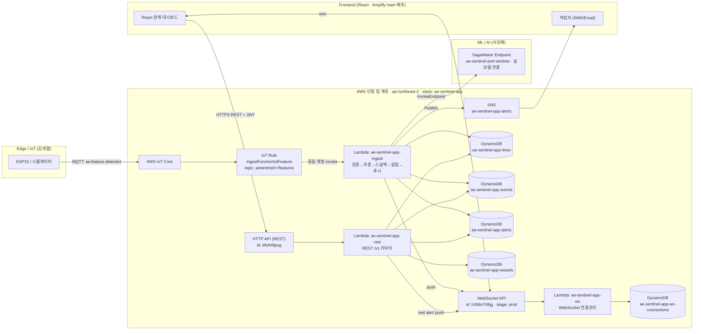

# AE-Sentinel — AWS Application 스택 가이드

> 분류: 현행 운영 가이드

> 이 문서는 **실제로 배포된** Application 백엔드(`ae-sentinel-app` 스택)의 구조와
> 리소스 이름의 의미, 그리고 팀원별로 이것을 어떻게 이해/사용해야 하는지를 정리한다.
>
> - 계정: **727847798739** (단일 팀 계정)
> - 리전: **ap-northeast-2 (서울)**
> - 배포 방식: **AWS SAM** — `backend/infra/application-account/template.yaml`
> - 스택 이름: **`ae-sentinel-app`**
> - 최종 확인: 2026-07-13 (SAM·Amplify·SageMaker·센서 마이그레이션 실배포)

> **2026-07-13 운영 상태:** `ae-sentinel-app`은 계류삭별 센서 API로 배포됐고,
> SageMaker Processing/Training과 Model Registry 승인 버전 1을 거친 모델
> `ae-port-window-xgb-v1-20260713`이 endpoint `ae-sentinel-port-window`에서 서비스된다.
> 프론트는 Amplify `main` Job 5로 수동 배포됐다. 상세 증적과 롤백 정보는
> [배포·센서 마이그레이션 보고서](../reports/deployment-migration-2026-07-13.md)를 따른다.

관련 문서: [권장 아키텍처](../architecture/ae_sentinel_recommended_architecture.md) · [인터페이스 계약](../contracts/team-collaboration-interfaces.md) · [REST OpenAPI](../../packages/contracts/openapi/ae-sentinel-rest.v1.yaml)

---

## 1. 한눈에 보기

모든 리소스는 **하나의 CloudFormation 스택(`ae-sentinel-app`)**으로 관리된다. 콘솔에서
CloudFormation → `ae-sentinel-app` → Resources 를 보면 아래 전부가 한 곳에 모여 있다.
직접 손으로 만들지 말고 **항상 SAM 템플릿을 통해** 바꾼다(Infrastructure as Code).



> **센서 위치 (2026-07-13 변경):** 피에조 센서는 **각 계류삭의 선박 측 연결 고리
> (아이·스플라이스 인근)**에 한 대씩 부착된다. 각 계류삭(line)은 전용 `sensorId`와
> `vesselId`를 가지며, 대시보드 지도는
> 선박 위치(위·경도)에 마커로 표시된다. 선박 정보는 `ae-sentinel-app-vessels`
> 테이블에서 관리한다.

---

## 2. 이름 규칙 (Naming) — 이름만 봐도 소속을 안다

- **접두사 `ae-sentinel-app-`** = 이 Application 스택 소유 리소스라는 뜻. (`ae-sentinel-app` 은 SAM 스택 이름이고, 대부분의 물리 이름은 `${스택이름}-<역할>` 형태로 자동 생성된다.)
- **역할 접미사**로 용도를 구분한다: `-lines / -events / -alerts / -ws-connections / -vessels`(DynamoDB), `-ingest / -rest / -ws / -docs`(Lambda), `-alerts`(SNS 토픽).
- **IAM 역할·권한·IoT 규칙**은 CloudFormation이 뒤에 랜덤 접미사를 붙인다 (예: `...-IngestFunctionRole-flp8mNPm0GyX`). 이 랜덤 값은 **재배포 시 바뀔 수 있으니 어디에도 하드코딩하지 말 것**. 참조는 논리 이름(아래 표의 "논리 ID")이나 스택 출력값을 쓴다.
- **API Gateway ID**(`kfethf9pug`, `h268o748jg`)는 생성 시 자동 부여된 식별자다. URL은 스택 출력값(`RestApiUrl`, `WebSocketConnectUrl`)으로 확인한다.

> 요약: `ae-sentinel-app-*` 로 시작하면 "우리 백엔드 스택 리소스", 접미사로 "무슨 역할"인지 읽으면 된다.

---

## 3. 리소스 인벤토리 (배포된 실제 이름)

| 논리 ID | 물리 이름 | 타입 | 역할 | 주 소유 |
|---|---|---|---|---|
| IngestFunction | `ae-sentinel-app-ingest` | Lambda | IoT 이벤트 검증 → 추론 오케스트레이션 → 스냅백 → 알림 → 실시간 푸시 | App |
| PiezoIngestFunction | `ae-sentinel-app-ingest-piezo` | Lambda | 피에조(진동수 전용) 리딩 → AE 특징량 변환(T∝f²) → 동일 추론 파이프라인 | App |
| RestFunction | `ae-sentinel-app-rest` | Lambda | REST `/v1` 전체 라우터 | App |
| WebSocketFunction | `ae-sentinel-app-ws` | Lambda | WebSocket `$connect`/`$disconnect` 연결 관리 | App |
| RestApi | HTTP API `kfethf9pug` | API Gateway (HTTP) | REST 엔드포인트 (`$default` 스테이지) | App |
| WebSocketApi | WebSocket API `h268o748jg` | API Gateway (WS) | 실시간 푸시 (`prod` 스테이지) | App |
| LinesTable | `ae-sentinel-app-lines` | DynamoDB | 계류삭 최신 상태 (PK `lineId`) | App |
| EventsTable | `ae-sentinel-app-events` | DynamoDB | 이벤트 이력 (PK `eventId`) | App |
| AlertsTable | `ae-sentinel-app-alerts` | DynamoDB | 알림 이력 (PK `alertId`) | App |
| ConnectionsTable | `ae-sentinel-app-ws-connections` | DynamoDB | WebSocket 연결 ID (PK `connectionId`) | App |
| VesselsTable | `ae-sentinel-app-vessels` | DynamoDB | 선박 정보 (PK `vesselId`, 위·경도 포함) | App |
| DocsFunction | `ae-sentinel-app-docs` | Lambda | 공개 Swagger UI(`/docs`) + 스펙(`/openapi.yaml`) | App |
| AlertsTopic | `ae-sentinel-app-alerts` | SNS | 작업자 경보 발송 토픽 | App |
| IngestFunctionIotFeature | `IngestFunctionIotFeature_*` | IoT TopicRule | `SELECT * FROM 'aesentinel/+/features'` → ingest 호출 | Edge↔App |
| *FunctionRole | `ae-sentinel-app-*Role-<rand>` | IAM Role | 각 Lambda 실행 역할(최소 권한) | App |
| *Permission | `ae-sentinel-app-*Permission-<rand>` | Lambda Permission | IoT/API GW가 Lambda 호출 허용 | App |

### 스택 출력값 (엔드포인트)

| 출력 | 값 |
|---|---|
| `RestApiUrl` | `https://kfethf9pug.execute-api.ap-northeast-2.amazonaws.com` (경로 앞에 `/v1`) |
| `WebSocketConnectUrl` | `wss://h268o748jg.execute-api.ap-northeast-2.amazonaws.com/prod` |
| `WebSocketCallbackUrl` | `https://h268o748jg.execute-api.ap-northeast-2.amazonaws.com/prod` (백엔드가 push에 사용) |
| `AlertsTopicArn` | `arn:aws:sns:ap-northeast-2:727847798739:ae-sentinel-app-alerts` |

> 언제든 최신 값 확인:
> ```bash
> aws cloudformation describe-stacks --stack-name ae-sentinel-app \
>   --region ap-northeast-2 --profile ae-sentinel \
>   --query "Stacks[0].Outputs" --output table
> ```

---

## 4. 데이터 흐름 (무엇이 어떻게 흐르나)

**실시간 경로 (쓰기)**
1. ESP32/시뮬레이터가 `aesentinel/<sensorId>/piezo`로 원시 주파수 또는 `aesentinel/<sensorId>/features`로 특징 이벤트를 MQTT publish.
2. IoT Rule이 **동일 계정**에서 `ae-sentinel-app-ingest`를 호출(Lambda Permission).
3. ingest가 스키마·범위·중복(eventId) 검증 → SageMaker(`SAGEMAKER_ENDPOINT`, 현재 미설정이라 내장 mock) 추론 → 위험도 판정.
4. `DANGER`면 스냅백 반경/폴리곤 계산.
5. 결과를 `-events`에 저장, `-lines` 최신 상태 갱신, `DANGER`면 `-alerts` 저장 + SNS 발송.
6. `-ws-connections`의 모든 연결로 WebSocket 메시지 push.

**조회 경로 (읽기)**
- 대시보드가 HTTP API(`/v1/...`)로 `ae-sentinel-app-rest` 호출 → DynamoDB에서 읽어 응답. (IoT/ML 직접 접근 없음)

**실시간 경로 (구독)**
- 대시보드가 WebSocket(`wss .../prod`)에 `$connect` → `ae-sentinel-app-ws`가 연결 ID를 `-ws-connections`에 저장 → 이후 ingest/rest가 이 연결들로 push.

WebSocket 메시지 타입 계약: [`ws-risk-message.v1.json`](../../packages/contracts/schemas/websocket/ws-risk-message.v1.json)
(`line.status.updated`, `risk.caution.detected`, `risk.danger.detected`, `snapback.zone.updated`, `alert.sent`, `device.offline`).

---

## 5. 팀원별로 이렇게 이해하면 된다

**공통**
- 백엔드 인프라는 **스택 하나(`ae-sentinel-app`)**가 전부다. 변경은 항상 `backend/infra/application-account`에서 SAM으로.
- 리소스 이름 접두사(`ae-sentinel-app-`)와 접미사(역할)만 보면 소속/용도를 안다.

**김세엽 (Edge / IoT)**
- 완료 기준: 디바이스가 `aesentinel/<sensorId>/piezo`로 피에조 원시 이벤트 계약을 지켜 publish하고 `source.deviceId`와 배정된 `lineId`를 일치시키는 것.
- 그 뒤는 IoT Rule → `ae-sentinel-app-ingest`가 자동 처리. 토픽/계약만 맞추면 됨.
- 테스트: IoT Core MQTT test client에서 예제 payload publish → CloudWatch에서 ingest 로그 확인.

**서강재 (ML / AI)**
- 완료 기준: `inference-request.v2` 윈도 입력에 `inference-response.v1`을 반환하는 SageMaker 엔드포인트.
- 연결: 엔드포인트 배포 후 이름을 `SAGEMAKER_ENDPOINT` 파라미터로 재배포하면 mock→실제로 전환(같은 계정이라 AssumeRole 불필요).
- 미연결 동안 백엔드는 내장 mock 분류기로 동작하므로 다른 팀이 막히지 않는다.

**김태훈 (App / Frontend)**
- REST/WS URL은 위 스택 출력값 사용. 조회는 `/v1/*`, 실시간은 `wss .../prod`.
- 재배포·로그·정리는 아래 6장.
- 인증(Cognito JWT)·프론트는 이어서 붙일 예정.

---

## 6. 운영 (재배포 · 로그 · 정리)

```bash
# 재배포 (코드/템플릿 변경 후) — backend/infra/application-account 에서
sam build && sam deploy --profile ae-sentinel

# ML/Bedrock/이메일 연결 시 파라미터 지정 예
sam deploy --profile ae-sentinel --parameter-overrides \
  SageMakerEndpointName=ae-sentinel-endpoint \
  BedrockModelId=anthropic.claude-3-haiku-20240307-v1:0 \
  AlertEmail=team@example.com

# 함수 로그 실시간 보기
sam logs --stack-name ae-sentinel-app --name IngestFunction --tail --profile ae-sentinel

# 전체 스택 삭제 (모든 리소스 제거)
sam delete --stack-name ae-sentinel-app --profile ae-sentinel
```

**비용**: 전부 종량제(Lambda / DynamoDB on-demand / API Gateway / SNS) + IoT Rule. 유휴 시 사실상 0원, 호출량만큼만 과금. 상시 과금(EC2/NAT) 없음.

**보안 (현재 상태)**: REST API에 **아직 인증이 없다**(공개). 프론트 작업과 함께 **Cognito JWT authorizer**를 붙일 예정. 그 전까지 URL 공유에 주의.

---

## 7. 파라미터 (배포 시 조정 가능)

| 파라미터 | 기본값 | 의미 |
|---|---|---|
| `SageMakerEndpointName` | (빈값) | 비우면 mock 분류기, 지정하면 실제 엔드포인트 호출 |
| `BedrockModelId` | (빈값) | 비우면 한국어 템플릿 경보문, 지정하면 Bedrock 생성 |
| `AlertEmail` | (빈값) | 지정하면 SNS 이메일 구독 자동 생성 |
| `IoTTopicFilter` | `aesentinel/+/features` | ingest가 듣는 MQTT 토픽 필터 |
| `PiezoTopicFilter` | `aesentinel/+/piezo` | 피에조 어댑터(ingest-piezo)가 듣는 MQTT 토픽 필터 |
| `WebSocketStageName` | `prod` | WebSocket 스테이지 이름 |
